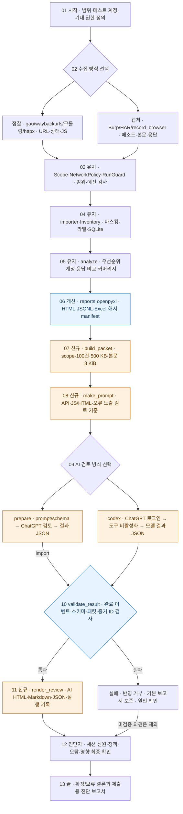

# v8.4.1 전체 흐름 — 시작에서 끝까지

시간은 위에서 아래로 흐릅니다. 좌우 분기는 입력 방식·검토 방식 선택이나 실패 처리입니다. `유지`는 v8.2 기능, `신규`와 `개선`은 이번 실행 코드 통합입니다.

Codex 완료 이벤트 검사는 자동 CLI 경로에서만 적용됩니다. 수동 import는 모델 호출·구독 등급을 검증하지 않습니다. 13단계는 진단자가 최종 확인한 결론을 작성하는 업무 단계이며 자동 취약점 확정이 아닙니다.

| 단계 | 실제 도구·모듈 | 얻는 데이터 / 산출물 | 대상 요청 |
|---|---|---|---|
| 01 | scope 파일·라벨 입력 | 허용 호스트·actor/tenant/scenario·기대 권한 | 없음 |
| 02 정찰 | collect_urls.sh·gau·waybackurls·crawl_safe.py·guarded_probe.py·JS 캐시 | URL·프로빙 상태·수집한 JS·정적 endpoint | 아카이브 또는 대상 접속 발생 |
| 02 캡처 | Burp·HAR·record_browser.py | 사용자가 수행한 실제 HTTP 요청·응답·시간 | 사용자가 기능을 실행하며 발생 |
| 03–04 | Scope·NetworkPolicy·RunGuard·importer·Inventory | 마스킹된 인벤토리와 출처·관찰 상태 | import 자체는 없음 |
| 05 | recon81.analysis | 후보 이유·미수집 항목·동일 자원 계정 비교·커버리지 | 없음 |
| 06 | recon81.reports·openpyxl | requests.jsonl·analysis.json·evidence/*.json·HTML·Excel·manifest | 없음 |
| 07 | recon81.ai_review.build_packet | 선택 증거·필드·응답·계정 맥락·비교·해시·생략 수 | 없음 |
| 08 | recon81.codex_review.make_prompt | 고정 판단 기준 + UNTRUSTED_EVIDENCE_JSON | 없음 |
| 09 수동 | ai_review.py prepare·ChatGPT·import | prompt.txt·schema.json·AI 반환 JSON | 모델 서비스에 데이터 제공 |
| 09 자동 | ai_review.py codex·공식 Codex CLI | ChatGPT 로그인 preflight·완료 이벤트·결과 JSON | 모델 서비스 통신 |
| 10–11 | validate_result·render_review | 검증된 형식의 AI 의견·초안·미검토 수·별도 보고서 | 없음 |
| 12–13 | 진단자·최종 문서 작성 | 검증 사실·판단 한계·개선안·최종 PDF 등 | 추가 검증은 별도 승인 범위에서 수행 |

기존 httpx 20개 워커와 각 `-rl 10 -t 5`를 유지합니다. AI 단계는 새로운 대상 요청을 만드는 진단 단계가 아닙니다. 현재 환경의 실제 CLI 모델 호출은 미검증이며, 모의 어댑터 테스트와 수동 결과 가져오기 통합 테스트를 수행했습니다.
