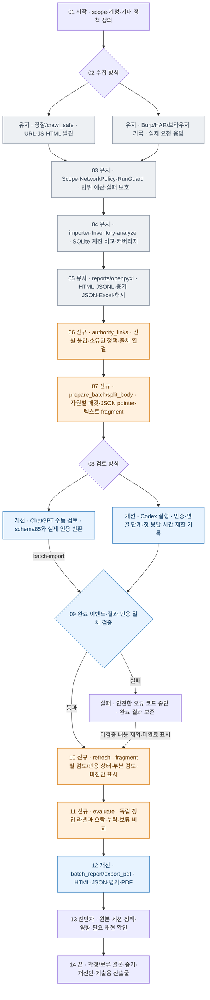

# v8.5 전체 흐름 — 시작부터 최종 산출물까지

시간은 위에서 아래로 흐릅니다. 좌우는 수집·검토 방식 선택 또는 실패 처리입니다. 신규/개선은 v8.4.1 대비 변경이며 최종 취약점 확정과 재현 판단은 사람이 수행합니다.

실패 후에는 원인을 확인하고 명시적인 --retry-failed로 해당 묶음을 재시도합니다. 완료된 결과는 해시·스키마·인용을 검증한 후 재사용합니다. 실패 결과를 통과 경로에 합치지 않습니다. 새 증거는 새 batch로 준비합니다.

| 단계 | 도구 | 얻는 데이터·산출물 |
|---|---|---|
| 01–03 | scope·계정 입력, crawl_safe, Burp/HAR, NetworkPolicy/RunGuard | 발견 URL·관찰된 메소드/파라미터·상태/헤더/본문·수집 범위 |
| 04–05 | request_inventory, Inventory, analyze, reports, openpyxl | SQLite·후보·동일 자원 계정 비교·HTML·Excel·evidence JSON·manifest |
| 06 | review_evidence.authority_links | 성공 신원 응답·ID/역할·capture 라벨 관계·정책 출처·미제공 표시 |
| 07 | review_batch.prepare_batch, split_body | batch.json·packet/schema/prompt·원본 pointer·본문 fragment·작업 목록 |
| 08–09 | execute_packet 또는 batch-import, validate_citations | 단계별 실패 코드·완료 이벤트·검증된 필드/발췌·인용 JSON·묶음 결과 |
| 10 | refresh | progress.json·coverage.json·발견/관찰/부분 검토/검토/인용 확인 상태 |
| 11 | review_reporting.evaluate | 정답 출처·오탐/누락/보류·정답 범위의 precision/recall·상충 의견 |
| 12–14 | batch_report, export_pdf, 진단자 | HTML·Markdown·JSON·PDF·확정/보류 결론·개선안 |

수집 경로는 선택에 따라 대상 요청이 발생합니다. AI 실행은 모델 서비스에 선택 증거를 전달하며 대상 진단 요청을 만들지 않습니다. 오프라인 준비·가져오기·평가·PDF 생성은 대상 요청이 없습니다. 기존 httpx 20워커와 각 -rl 10 -t 5는 유지합니다. 구독 등급·실제 재현·판정 의미를 인용 일치 검사로 보증하지 않습니다.
