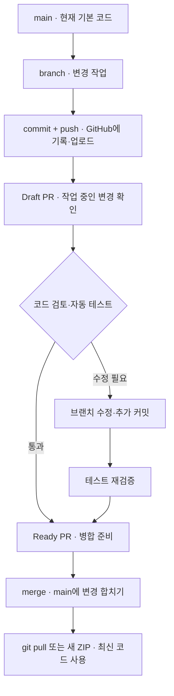

# GitHub 작업 과정

`main`은 기본 코드입니다. GitHub 첫 화면·일반적인 clone·기본 ZIP 다운로드는 main 기준입니다.

**브랜치(branch)**는 main과 분리해 변경을 만드는 작업 갈래입니다. 브랜치에 업로드했다고 main까지 바뀐 것은 아닙니다. **커밋(commit)**은 그 갈래에서 변경 내용을 저장한 기록입니다.

**PR(Pull Request)**은 브랜치의 변경을 main에 합쳐 달라는 검토 요청입니다. 변경 파일·설명·자동 테스트 결과를 한 화면에서 확인할 수 있습니다. **Draft PR**은 아직 작업 중인 초안 상태이며, 검토 준비가 끝나면 Ready로 전환합니다. **병합(merge)**이 완료되어야 변경이 main에 들어갑니다.

이번 변경은 `codex/disclosure-review-prompt` 브랜치와 PR #1에서 관리합니다. GitHub에 올라간 코드와 컴퓨터에서 실행하는 코드는 별개입니다. 기존 로컬 설치는 main을 pull하거나 새 ZIP을 받아야 업데이트됩니다. GitHub에 병합해도 이미 실행 중인 프로그램이 자동 교체되지는 않습니다.
