# 유스케이스와 기능 변경

현재 비교 기준: **8.6.0 → 8.6.1**. [AI 실행 수정 안내](V861.md) · [남은 단계](REMAINING_STEPS.md). 아래 이전 버전의 전체 프로세스와 변경 기록도 유지합니다.

## v8.6.1 — 저장 증거의 실제 AI 분석

주황/신규는 전송 스키마 호환 처리, 파랑/개선은 시작·경고·결과 검증, 회색/유지는 저장 증거와 기존 ChatGPT 로그인입니다. 진단자·검토자는 시스템 경계 밖에 있습니다.

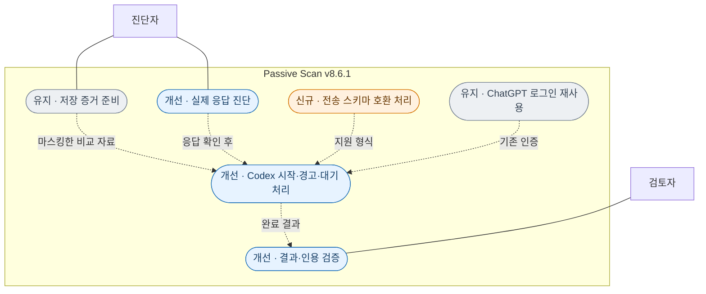

분석 프로세스는 별도 임시 폴더에서 명시적인 저장 증거 프롬프트만 처리합니다. 프로젝트 문서 탐색·스킬 설치·훅·알림을 이 프로세스에서 끄며, 호출자의 저장소 지침과 CLI 관리 정책·읽기 전용 샌드박스는 유지합니다. 배치의 첫 모델 응답은 기본 180초까지 기다리되 전체 실행 제한은 300초로 유지합니다. 경고만으로 검토 완료를 인정하지 않습니다. 전송 스키마를 조정해도 원본 결과 계약의 중복 ID·인용 검사는 유지합니다.

이전 비교 기준: **8.5.2 → 8.6.0**. [최적화·고도화 안내](V86.md).

## v8.6.0 — 수집부터 보고서까지

주황/신규는 독립 이벤트 이력, 파랑/개선은 요청 보호·전체 증거 보존·비교·보고서, 회색/유지는 ChatGPT 로그인 Codex와 사람의 최종 판단입니다. 역할은 시스템 경계 밖에 표시합니다.

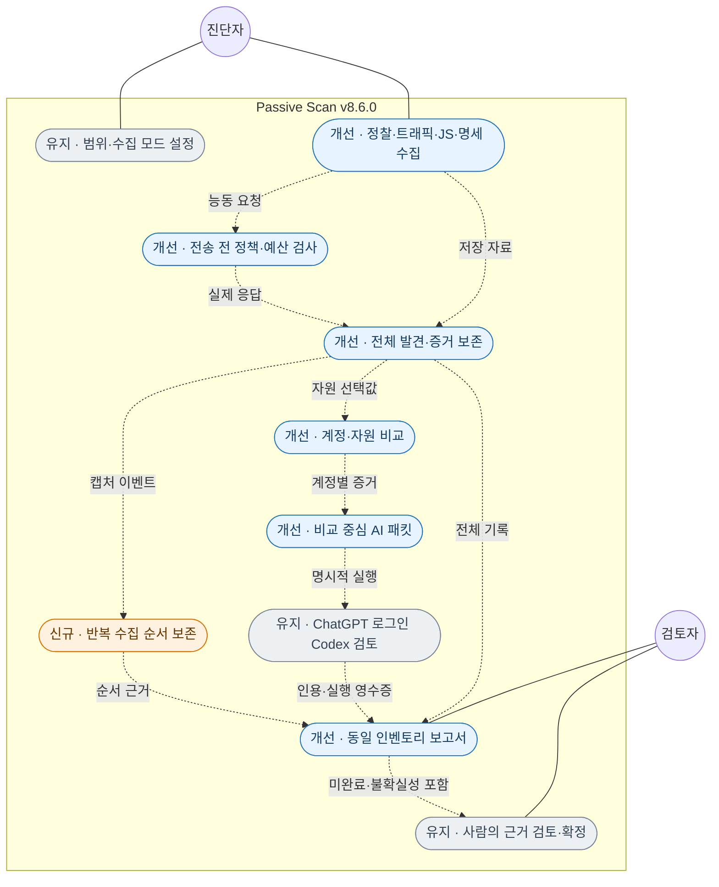

오프라인 import·보고서·AI 패킷 준비는 대상 요청을 보내지 않습니다. 능동 도구는 고정 버전과 로컬 프록시로 전송을 통제합니다. httpx20워커·각 `-rl 10 -t 5`는 유지합니다. 실제 Codex 검토는 CLI probe가 정상 완료된 환경에서 실행하며, 현재 환경의 모델 미완료 상태를 숨기지 않습니다.

## v8.6.0 — 저장·재사용·출력 개선

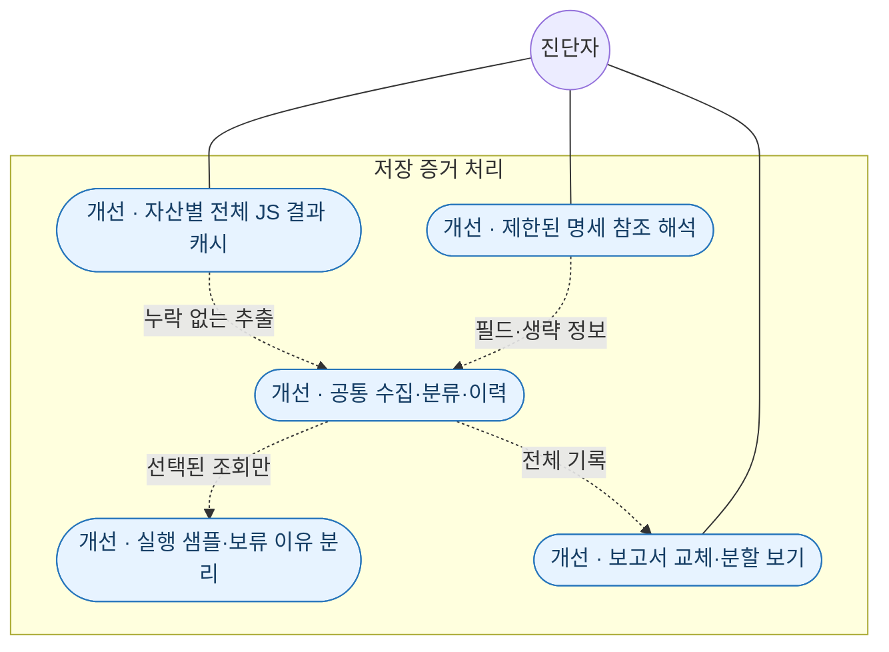

이전 비교 기준: 8.5.1 → 8.5.2.

## v8.5.2 — 로컬 재현과 실행 시작 진단

주황/신규는 고정 실습 표본 재현, 파랑/개선은 실행 단계·실패 진단, 회색/유지는 저장 증거 검토입니다. 사람과 외부 실습 서버는 시스템 경계 밖에 있습니다.

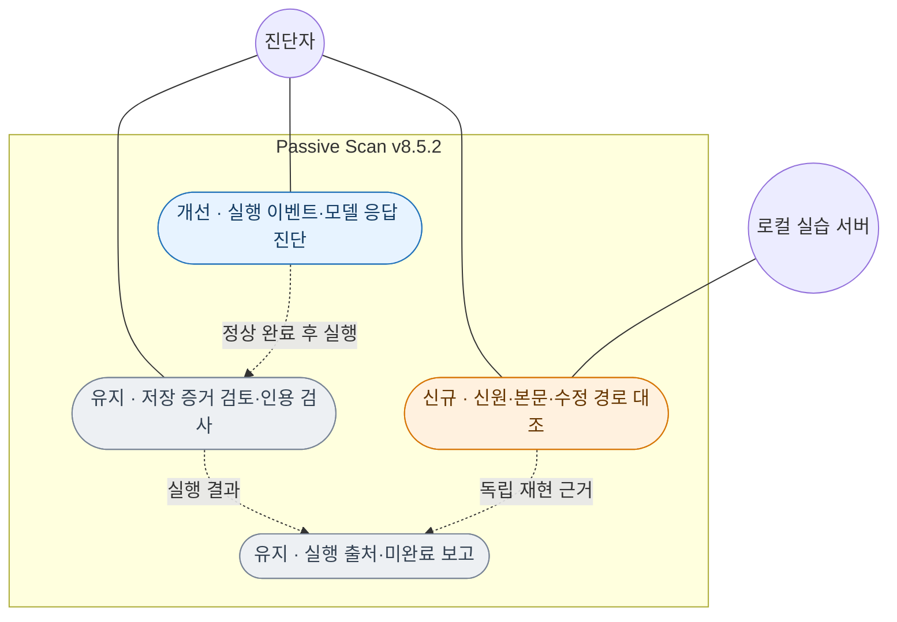

재현기는 교육용 고정 표본에만 사용하며 일반 대상의 자동 로그인·AI 자동 재현 기능이 아닙니다. ChatGPT 로그인 Codex CLI 사용으로 충분하며 구독 등급 검증은 완료 조건이 아닙니다. 로컬 재현 성공과 실제 모델 완료·사람 최종 확정은 구분합니다.

이전 비교 기준: 8.5.0 → 8.5.1.

## v8.5.1 — 실행 진단과 남은 작업 연결

주황/신규는 실행 전 진단, 파랑/개선은 제한 설정·실행 출처 연결, 회색/유지는 기존 증거 처리입니다.

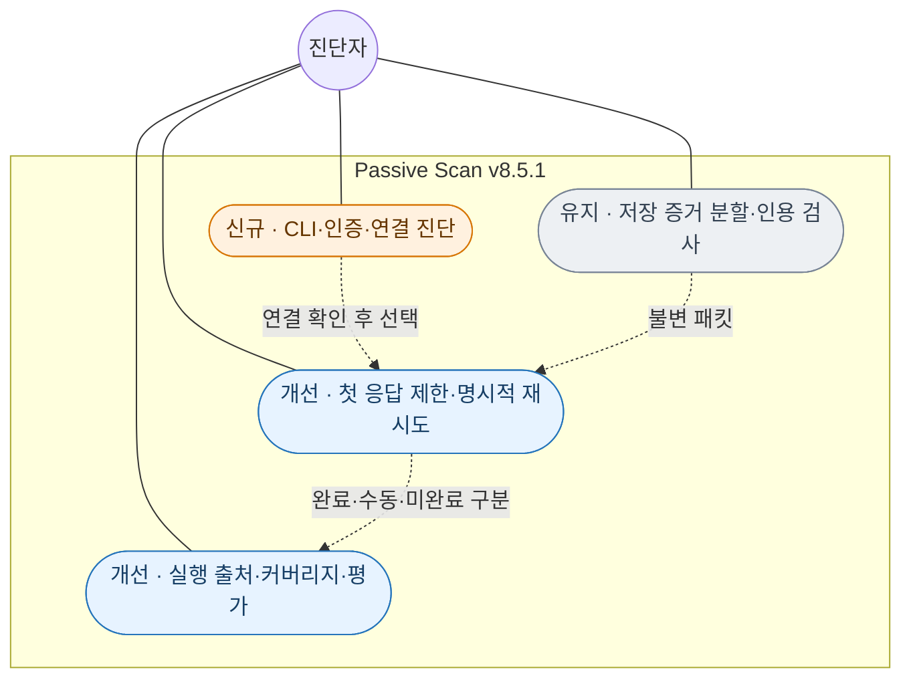

기본 doctor는 설정만 검사합니다. --probe는 고정된 무해한 JSON 요청 한 건을 모델 서비스에 보내며, 대상 증거와 대상 요청을 포함하지 않습니다. 실제 실행 확인은 모델 판정의 정확성·구독 등급·재현 확인과 별도입니다.

이전 비교 기준: 8.2.0 → 8.4.1. 아래 v8.2 그림은 이전 변경 기록이며, 최신 전체 흐름은 [시간순 전체 흐름도](FLOW_V84.md)를 참고하세요.

이전 비교 기준: 8.1.1 → 8.2.0. **주황색/신규**는 추가한 기능, **파란색/개선**은 확장한 기능, **회색/유지**는 기존 기능입니다. 실선은 역할의 사용 관계, 점선은 포함하거나 선택적으로 확장하는 기능의 관계입니다.

## 전체 프로세스

운영자는 범위를 설정하고 정찰 또는 수동 트래픽 가져오기를 선택합니다. 수집 자료는 scope·마스킹·중복 관리를 거쳐 인벤토리에 저장됩니다. 검토자는 보고서에서 후보·계정 차이·기능 흐름·미확인 영역을 검토합니다. 필요한 경우에만 선택한 조회 요청을 별도 예산으로 실행하고 그 결과를 다시 인벤토리에 연결합니다.

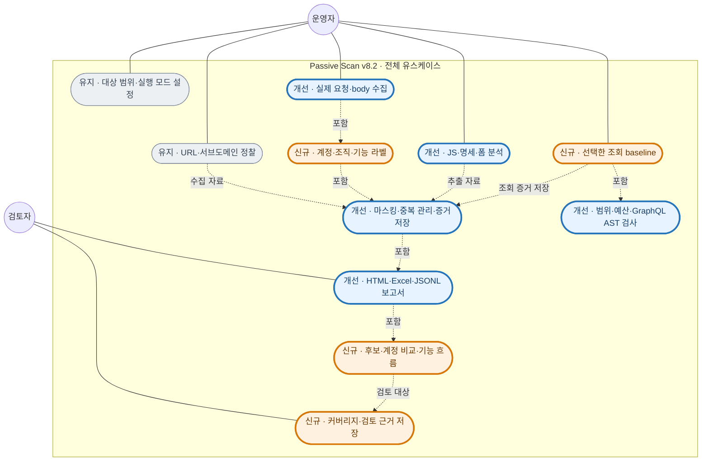

실선은 역할이 사용하는 기능입니다. 점선의 `포함`은 하위 기능, `수집/추출 자료`와 `증거 저장`은 처리 결과 연결입니다. 순서만 나타내는 순서도가 아니라, 누가 어떤 기능을 사용하는지와 기능의 관계를 표시합니다. 아래 세부 다이어그램에서 개별 수집·분석·검증 기능을 확인할 수 있습니다.

기본 정찰의 httpx 20개 워커와 각 `-rl 10 -t 5`는 유지합니다. 오프라인 가져오기·분석·보고서는 추가 대상 요청이 없습니다. 자동 정찰/스크린샷과 선택 조회 baseline은 실제 요청이 발생하며 예산·scope 검사를 받습니다. 취약점 판정은 검토자가 증거 근거를 남겨 결정합니다.

## 자료 수집과 증거 저장

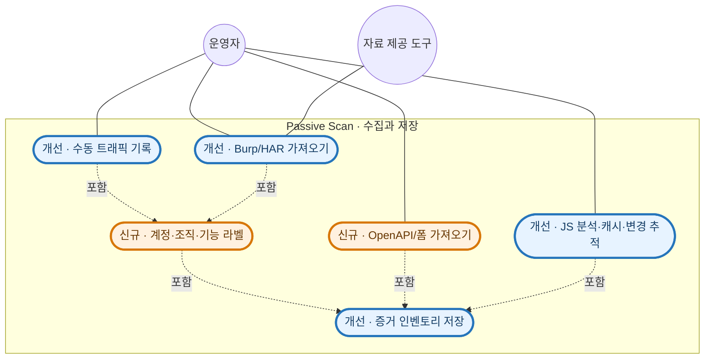

수동 사용 중의 실제 요청은 그대로 전송되며, 기록기는 자동 클릭·자동 폼 제출을 하지 않습니다. 명세/폼/JS 정보는 정적 발견으로 구분하고 실제 body 값을 생성하지 않습니다. JS 캐시의 재사용은 현재 서버 내용 재확인을 의미하지 않습니다.

## 검토와 선택적 조회 검증

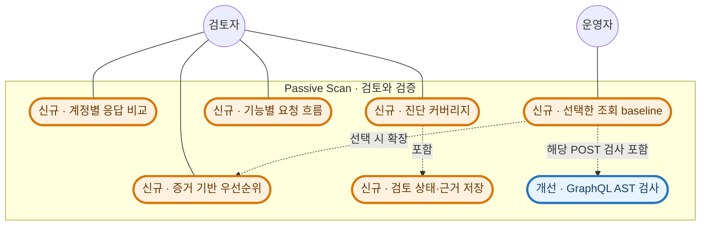

baseline은 CLI에서 `--active`와 선택한 ID를 지정해 실행합니다. 자동 payload 변경·변경 메소드 실행·취약점 확정은 없습니다. HTTP 상태/응답 차이는 검토 근거이며 `confirmed`나 `false_positive`는 검토자가 증거 메모와 함께 기록합니다.

## 유지하는 네트워크 기능

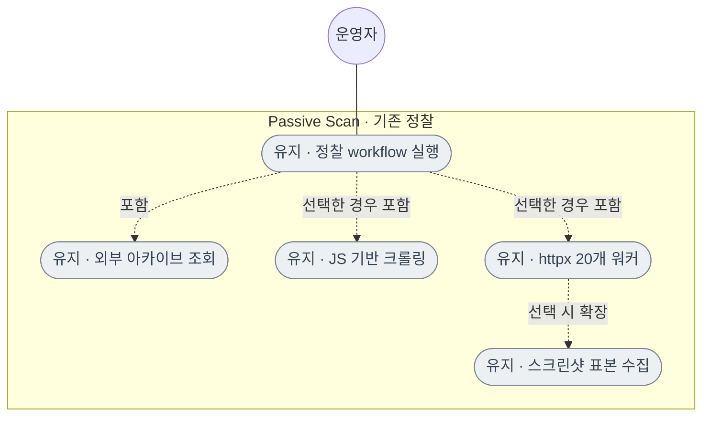

각 httpx 워커의 **`-rl 10 -t 5`는 변경하지 않았습니다.** 조회 검증 큐의 별도 예산은 기존 httpx 설정을 대체하지 않습니다. 8.1.1에서 추가한 scope·과부하 중단·수집 예산·부분 결과 보존도 유지합니다.

이 파일은 이후 기능 변경 때 해당 변경점과 범례를 갱신하는 기준 문서입니다. 세부 사용법과 제한은 [v8.2 안내](V82.md)를 참고하세요.

## 정보 노출 AI 검토 프롬프트 적용 패키지

API 민감정보 과다 노출, JS/HTML 비밀정보 노출, 오류 내부정보 노출의 검토 지시문·코드 패치·적용 도구·검증 결과를 [적용 패키지](../updates/v8.4-disclosure-prompt/README_KR.md)에 보관합니다. 이 패키지는 프롬프트 변경 당시의 보관 자료입니다. v8.4.1에서는 아래 실행 코드에 직접 통합했습니다.

[패치 적용 이후의 전체 흐름 및 유스케이스](../updates/v8.4-disclosure-prompt/docs/PROMPT_DISCLOSURE_REVIEW.md)

## v8.4.1 실행 코드 — 이전 유스케이스

[실제 실행 안내](V84.md) · [도구·데이터를 포함한 시간순 전체 흐름](FLOW_V84.md)

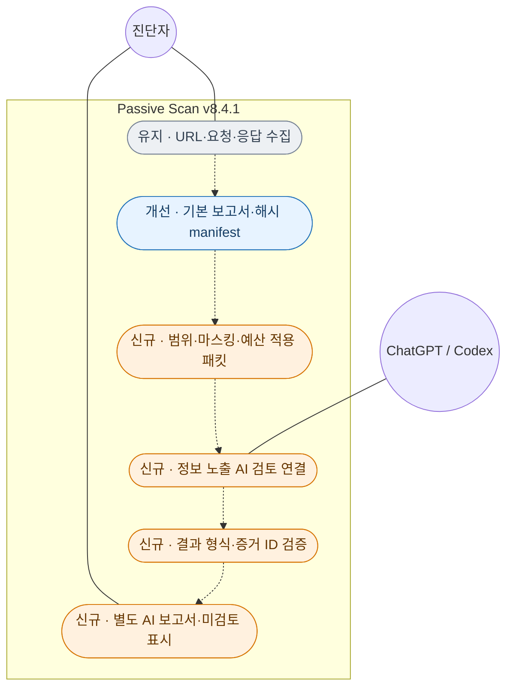

역할은 시스템 경계 밖에 있습니다. AI 의견을 human confirmed 상태로 자동 반영하지 않으며, 진단자가 최종 검토합니다. 기존 수집·계정 비교·선택 조회 기능은 유지합니다.

## v8.5.0 — 이전 버전의 전체 유스케이스

비교 기준: v8.4.1 → v8.5.0. 주황/신규, 파랑/개선, 회색/유지입니다. 전체 시간순 흐름과 도구·데이터는 [v8.5 전체 흐름](FLOW_V85.md), 실행 명령은 [v8.5 안내](V85.md)를 참고하세요.

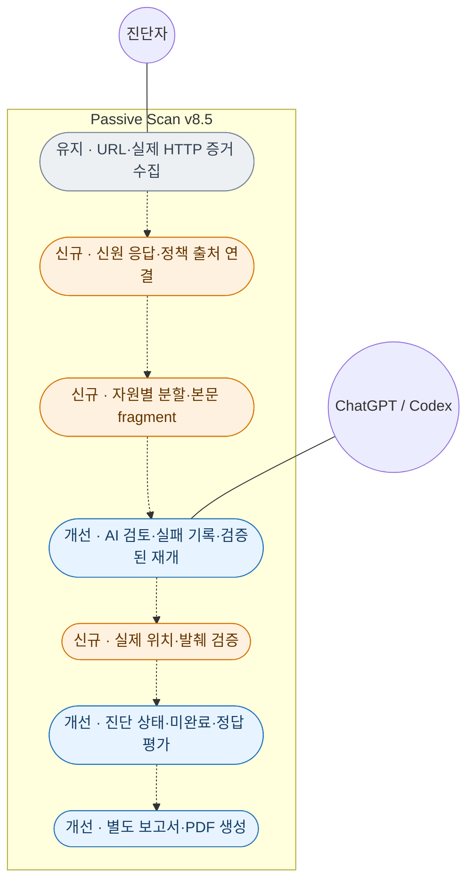

계정 탐색·자동 로그인·AI 대상 재현·자동 finding 확정은 포함하지 않습니다. 인용 일치는 의미와 영향의 자동 검증이 아니며, 사람의 재현·최종 확인과 별도입니다. 기존 httpx 설정을 유지합니다.
