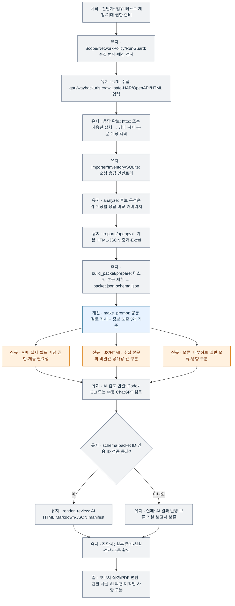
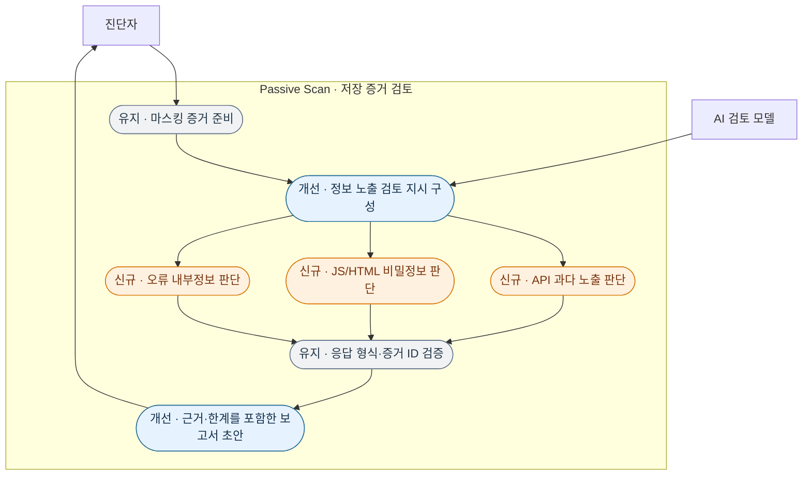

# 정보 노출 AI 검토 프롬프트 개선

적용 대상: 이전에 확인한 v8.4 `recon81/codex_review.py`의 `make_prompt()`.
현재 상태: 적용용 패치 작성 및 알려진 함수 기준 검증 완료. 최신 전체 개발본 복구 전이므로 실제 프로젝트 반영과 전체 회귀 테스트는 미완료.
GitHub main은 2026-10-14 확인 시 8.2.0, `ab2e508674563f4e3c41b5bc353bb1ff7ecfc43f`이며 AI 검토 파일이 없다.

## 검토 기준

| 구분 | 입력과 확인 기준 | 오탐 제외·한계 |
| --- | --- | --- |
| 신규 · API 응답 민감정보 과다 노출 | 응답 필드, 호출 계정·역할, 소유권, 기대 권한, 제공 필요성 | 공개 정보·허용된 본인 정보와 구분. UI 숨김만으로 권한 위반 확정 금지 |
| 신규 · JS/HTML 비밀정보 노출 | 이미 수집한 JS·HTML·주석·설정·소스맵 본문의 비공개 값 | 공개용 키·클라이언트 ID·예제·실습·마스킹 값 구분. 파일 URL만으로 본문 확보 판단 금지. 키 유효성 미확인 |
| 신규 · 오류 내부정보 노출 | 스택 트레이스·SQL·DB 구조·절대 경로·내부 호스트·디버그 정보 | 일반 오류와 구분. DB 오류로 SQLi, 스택으로 RCE 확정 금지. 버전·내부 경로만으로 위험도 과장 금지 |
| 개선 · 증거·보고서 근거 | observation_id, 필드 JSON 경로·본문 위치, 마스킹 발췌, 실제 관찰과 추론 구분 | 비밀값 원문 출력 금지. 잘림·생략·마스킹 때문에 확인 불가하면 명시 |
| 유지 · 실행·형식 | 저장 증거만 검토, 추가 테스트는 계획, 기존 JSON schema·3개 판단 분류 | 도구·대상 요청·로그인·키 검증·파일 변경 금지. 사람 확정과 분리 |

본문을 수집하거나 JS를 새로 다운로드하는 변경은 포함하지 않는다. 마스킹·본문 제한·입력 패킷 구성·모델 선택·CLI 권한 설정·출력 schema·httpx 20워커와 각 `-rl 10 -t 5`는 이 패치의 수정 대상이 아니다.

## URL 수집부터 최종 산출물까지 전체 흐름

아래는 패치를 적용한 이후의 설계 흐름이다. 일부 수집 도구는 환경·범위에 따라 선택하며 이 수정 작업에서 실행하지 않았다. PDF 변환은 AI 검토 프로세스와 별도의 보고서 작성 단계이다.

## 핵심 유스케이스

## 적용 및 검증 범위

1. 최신 v8.4 전체 소스가 있어야 한다. v8.2에는 적용하지 않는다.
2. `python apply_prompt_update.py --project /path/to/passive-scan`으로 기존 함수 일치 여부를 확인한다.
3. 확인 후 같은 명령에 `--apply`를 추가한다. 기존 파일 백업과 문서 링크 갱신을 수행한다.
4. 원본 함수가 다르면 적용을 거부한다. 프롬프트가 이미 같은 수정안이면 중복 적용하지 않는다.
5. 제공한 검증은 알려진 이전 함수에 대한 패치 적용·JSON 보존·구문·멱등성 검사이다. 전체 프로그램 회귀나 실제 모델의 검출 성능 검증이 아니다.

AI 실행 시 자동 경로에는 같은 schema가 별도 옵션으로 전달된다. 수동 검토에서는 prompt.txt와 schema.json을 함께 제공해야 한다.
